# Szebastian

**Designer who builds small, honest apps.**

I spent ten years on posters, logos and type. Now I bring the same eye for detail to apps for everyday things: the weather, your money, the time, the night sky and your music. 
Each app shows its work. When the sources disagree, it tells you so, instead of hiding it behind one confident number.

<i>Don't just tell me the forecast. Tell me where the models agree.</i>

 

  

## Opera · the apps

Seven apps, one family. Install **hub** once and it keeps the other seven installed and up to date.

<table align="center">
  <tr>
    <td colspan="2" align="center">
      <a href="https://github.com/Szebastian31/hub"><b>hub</b></a> · Java · Android + PWA 
      One list, seven apps: Hora, Consensus Weather, Augur, Annales, Kalendae, Caelum and Fidelis.
    </td>
  </tr>
  <tr>
    <td width="50%" align="center" valign="top">
      ☁️ WEATHER 
      <a href="https://github.com/Szebastian31/Consensus_Weather"><b>Consensus Weather</b></a> 
      Thirteen weather models, and where they agree. 
      HTML · Android, iOS + browser
    </td>
    <td width="50%" align="center" valign="top">
      🕰 TIME 
      <a href="https://github.com/Szebastian31/hora"><b>Hora</b></a> 
      A clock, alarm, timer and stopwatch that tells you how right it is. 
      JavaScript · Android + PWA
    </td>
  </tr>
  <tr>
    <td align="center" valign="top">
      💸 MONEY 
      <a href="https://github.com/Szebastian31/kalendae"><b>Kalendae</b></a> 
      A forecast for your money: what's coming, and what's safe to spend until payday. 
      JavaScript · Android + PWA
    </td>
    <td align="center" valign="top">
      🌙 THE SKY 
      <a href="https://github.com/Szebastian31/caelum"><b>Caelum</b></a> 
      Hold your phone up and the real sky over you lines up behind the glass. 
      JavaScript · Android + PWA
    </td>
  </tr>
  <tr>
    <td align="center" valign="top">
      ✦ THE STARS 
      <a href="https://github.com/Szebastian31/augur"><b>Augur</b></a> 
      Your stars, six ways, and where they agree. 
      JavaScript · Android + PWA
    </td>
    <td align="center" valign="top">
      📮 YOUR DAYS 
      <a href="https://github.com/Szebastian31/annales"><b>Annales</b></a> 
      Your days, sealed as stamps. 
      Kotlin · Jetpack Compose · Android
    </td>
  </tr>
  <tr>
    <td colspan="2" align="center" valign="top">
      🎧 MUSIC 
      <a href="https://github.com/Szebastian31/fidelis"><b>Fidelis</b></a> 
      A faithful companion for your Spotify: mood mixes, discoveries, lyrics and a queue that remembers. 
      Kotlin · Android · Spotify + Last.fm
    </td>
  </tr>
</table>

 

## Numeri · the numbers

 

  

## Instrumenta · built with

 

## Subsidium · support

If one of these apps earned a spot on your phone, a coffee keeps the next one coming.

<b>Show all payment options & QR codes</b>

 

BLIK · debit / credit card · Google Pay / Apple Pay · online bank transfer, all on [buycoffee.to/szebastian](https://buycoffee.to/szebastian).

 

<i>Hora, Augur, Annales, Kalendae, Caelum, Consensus, Fidelis: Latin names for small, honest apps.</i>

